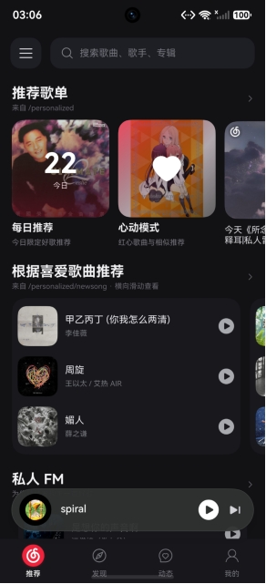
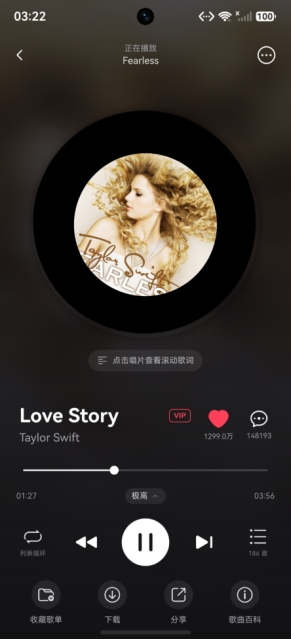
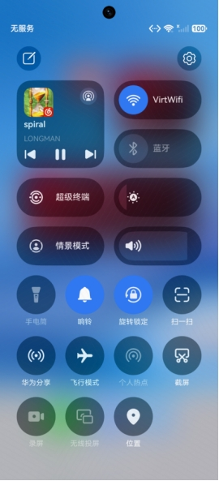
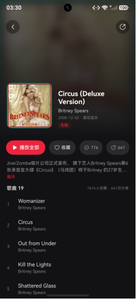
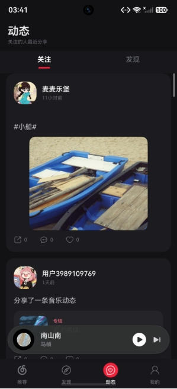
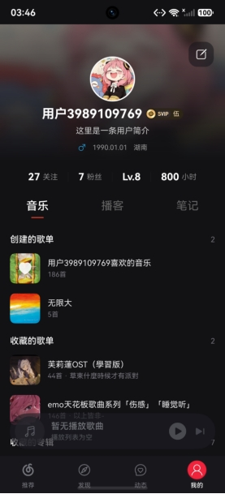

# HarmonyOS Music Player

使用 ArkTS 和 ArkUI 开发的 HarmonyOS 音乐客户端，采用 Stage 应用模型。数据源为网易云音乐 NodeJS API Enhanced。
## 项目信息

| 项目 | 当前配置 |
| --- | --- |
| 应用包名 | `com.hmos.cloudmusic` |
| 应用版本 | `1.0.0` |
| 主模块 | `entry` |
| 目标 SDK | HarmonyOS `6.1.1(24)` |
| 支持设备    | phone, tablet |
| 主 Ability | EntryAbility |
| 项目使用语言  | ArkTS |

## 应用截图

<table>
  <tr>
    <td align="center">推荐页面</td>
    <td align="center">播放详情页</td>
    <td align="center">系统播放组件</td>
  </tr>
  <tr>
    <td></td>
    <td></td>
    <td></td>
  </tr>
  <tr>
    <td align="center">专辑页面</td>
    <td align="center">动态页面</td>
    <td align="center">用户页面</td>
  </tr>
  <tr>
    <td></td>
    <td></td>
    <td></td>
  </tr>
</table>

## 功能模块

| 模块 | 当前功能 |
| --- | --- |
| 推荐与发现 | 每日推荐、私人漫游、心动模式、排行榜、新歌、曲风和场景音乐；浏览推荐歌单、专辑和歌手。 |
| 搜索 | 搜索歌曲、歌单、专辑、歌手、用户、播客等内容，保存本机搜索历史，并从结果进入对应详情页。 |
| 音乐播放 | 在线和本地音频播放、音质选择、播放进度控制、顺序播放、单曲循环、随机播放、睡眠定时、最近播放记录。开启流式加载时按需读取音频，关闭后使用整曲内存加载。 |
| 播放队列 | 下一首播放、移除、清空，通过右侧手柄拖动排序；多选后批量移除、下载或收藏到歌单。私人漫游在开始播放队尾歌曲时提前补歌，仅支持顺序播放和单曲循环。 |
| 歌曲详情与歌词 | 封面、歌手、专辑、评论、歌词、百科、乐谱和铃声入口；支持逐行歌词、逐字歌词及翻译等接口返回内容。歌词本通过点击歌词行进行摘录，可下载、复制和分享歌词。 |
| 个人音乐库 | “我的”页按音乐、播客、笔记分类，浏览创建和收藏的歌单、收藏专辑、最近播放和听歌排行；支持歌单编辑、歌曲管理与内容导入。 |
| 用户与歌手 | 用户主页、歌手主页、关注和粉丝列表、个人资料编辑、会员信息、等级、徽章中心和个人状态。自己的主页与其他用户主页顶部显示状态，支持查看接口提供的同状态推荐用户。 |
| 动态与消息 | 关注动态、发现动态、发布、转发、点赞、评论和分享；自己的动态可删除。个人和歌手动态支持列表 / 瀑布流切换，瀑布流预览图片、音乐封面、转发内容和纯文字。消息中心与私信支持查看会话和分享音乐内容。 |
| 播客与 MV | 播客分类、订阅列表、节目详情和播放；选择音频文件并上传声音到播客。MV 支持详情、播放、评论、点赞和分享。 |
| 本地、下载与云盘 | 通过系统文件选择器导入本地音频，读取元数据和封面、匹配线上歌曲信息、编辑本地资料；下载歌曲到选定位置，浏览和管理音乐云盘内容。 |
| 装扮与外观 | 跟随系统 / 深浅色主题、皮肤与主题色、背景、头像框、会员标识、红心效果等本地装扮。红心特效可使用自定义图片或动图；主页状态显示可在本机设置中关闭。 |
| 系统与辅助功能 | 后台播放、系统媒体播控、实况窗、桌面歌词、投播入口和桌面音乐卡片。大卡片支持切换播放顺序、上一首、播放 / 暂停、下一首和喜欢，并同步歌曲封面与播放状态。另提供麦克风 / 文件听歌识曲、听歌统计、设备管理、云贝及 AI 歌词创作。 |

## 设计说明

### 页面与交互

应用以推荐、发现、动态和我的为主导航，详情页通过 `Navigation` 和 `NavPathStack` 管理。歌单、歌手和用户主页使用统一的顶部栏：头图展开时隐藏标题，滚动时标题渐显并上移，二级菜单吸附在带透明模糊背景的顶部区域。用户标题可附带小头像和认证标识，歌手顶部可直接关注或取消关注。

歌曲更多操作使用半模态面板，顶部展示封面、歌名和歌手，操作以图标加单行文字排列。动态的分享和删除使用系统气泡菜单，评论、分享、状态用户列表及权限说明使用独立面板。

笔记瀑布流使用系统 `WaterFlow` / `FlowItem` 排列内容卡片。预览与列表详情分别渲染：窄列显示封面或文字、简短标题、作者和点赞；点击后进入动态详情。转发内容读取源动态预览，纯文字预览使用白底黑字。

### 状态与外观

`AuthStore` 保存当前账号状态，`PlayerStore` 保存歌曲、队列、播放位置和播放模式，通过 `@Provide` / `@Consume` 共享给页面和组件。播放操作统一交给 `PlayerController`，使应用内控件、系统播控和桌面卡片使用同一播放状态。

界面颜色通过 `ThemeColors` 统一读取，装扮和主题变化会通知组件刷新。主页状态的显示开关保存在本机偏好中，不修改服务端个人状态；状态查询与推荐请求携带时间戳，主页刷新时重新读取。

### 播放与系统集成

`PlayerController` 管理 `AVPlayer`、音源切换、音质和队列，使用请求标记避免快速切歌时加载过期音源。流式音源按 Range 分段读取，并使用有上限的块缓存；不启用流式加载时使用内存音源。

后台播放开启后通过动态加载的 `MediaSessionBridge` 创建媒体会话，向系统同步歌曲、封面、歌词、播放位置和循环方式，接收播放、暂停、切歌、拖动进度及播放顺序控制。实况窗和桌面歌词通过系统能力提供，具体布局由系统决定。

桌面卡片使用歌曲封面铺满背景，系统负责外缘圆角。卡片通过 `message` 和 `call` 把操作交给 `EntryAbility`，请求标记用于合并重复消息；点击卡片主体可通过 `router` 打开应用。`MusicWidgetService` 将播放状态和本地封面同步到已添加的卡片，网络封面加载不阻塞播放状态更新。

### 数据与文件

`ApiClient` 封装网络请求、Cookie、上传和可配置服务地址。业务服务分别处理歌曲、评论、播客、动态、资料、云盘和分享。登录状态、设置、播放模式等使用 Preferences，较大的队列、本地音乐索引、歌词摘录与装扮资料使用应用文件存储。

本地音频由用户通过系统文件选择器授权访问，后续读取使用持久化的文件授权；下载与导出遵循系统选择器返回的位置。系统分享使用 ShareKit，音乐私信通过音乐服务接口发送。

## 项目结构

```text
AppScope/                         应用标识、版本和资源
entry/src/main/module.json5       模块、权限、后台播放和扩展能力配置
entry/src/main/ets/
  entryability/                  应用生命周期、系统 Want 与卡片消息
  pages/                         主导航、详情、设置和业务页面
  components/                    播放器、面板、顶部栏、动态与歌词组件
  services/                      播放、网络、文件、装扮和系统能力
  stores/                        账号与播放状态
  models/                        接口、业务和权限说明数据模型
  musiccard/                     桌面卡片界面与 FormExtensionAbility
entry/src/main/resources/        图片、主题色、字符串、页面与卡片配置
```

## 构建与使用

1. 使用带 HarmonyOS SDK `6.1.1(24)` 的 DevEco Studio 打开项目并同步依赖。
2. 在签名配置中使用自己的证书和调试 Profile，连接设备或启动兼容的模拟器。
3. 构建并运行 `entry` 模块。默认产品为 `default`，应用包名为 `com.hmos.cloudmusic`。
4. 如需更换音乐服务，在侧边栏 → 设置 → 服务地址中填写兼容网易云音乐 API Enhanced 的后端地址。后端与客户端分别部署。
5. 登录后可同步个人资料、歌单、关注、消息等账号内容；本地音频通过“本地与下载”导入。AI 歌词功能需在设置中配置兼容的模型服务地址、API Key 和模型名称。

本项目使用 [网易云音乐 NodeJS API Enhanced](https://github.com/neteasecloudmusicapienhanced/api-enhanced) 作为数据源，需自行部署：


## 权限说明

以下清单对应 [entry/src/main/module.json5](entry/src/main/module.json5) 的实际声明。应用内可在设置页右上角“更多” → “应用权限申请说明”查看。

| 权限名称 | 权限描述 | 使用场景和目的 |
| --- | --- | --- |
| `ohos.permission.INTERNET` | 访问互联网。 | 请求音乐服务中的歌曲、歌词、封面、搜索和账号数据，播放在线音频、下载音乐及上传播客声音。 |
| `ohos.permission.GET_NETWORK_INFO` | 读取当前网络连接状态。 | 在播放页判断网络是否可用，决定本地歌曲能否使用在线歌词和其他网络功能。 |
| `ohos.permission.KEEP_BACKGROUND_RUNNING` | 在符合系统规则的场景下继续后台运行。 | 开启后台播放后，在后台或锁屏时继续播放音频，并响应系统媒体播控操作。 |
| `ohos.permission.MICROPHONE` | 使用麦克风采集声音。 | 用户启动麦克风听歌识曲时申请，用短时录音生成音频指纹并查询歌曲，录音结束后停止采集。 |
| `ohos.permission.FILE_ACCESS_PERSIST` | 持久化用户已授权的文件访问权限。 | 保存系统文件选择器导入的本地音频读取授权，应用重启后仍可访问和播放这些文件。 |

## 功能边界

- 在线业务依赖所配置后端提供的接口，歌曲音质、下载、付费内容与账号权限、版权有关。
- 徽章和状态由音乐服务返回。`/user/social/status/rcmd` 只提供登录用户的同状态推荐，不支持指定其他人的状态或分页；每次刷新重新请求。
- 系统媒体播控、实况窗、桌面歌词、投播和卡片更新依赖设备及系统支持。
- AI 功能生成和润色歌词、标题与创作说明，当前不生成可播放的音频；系统内部音频录制识曲尚未开放。
